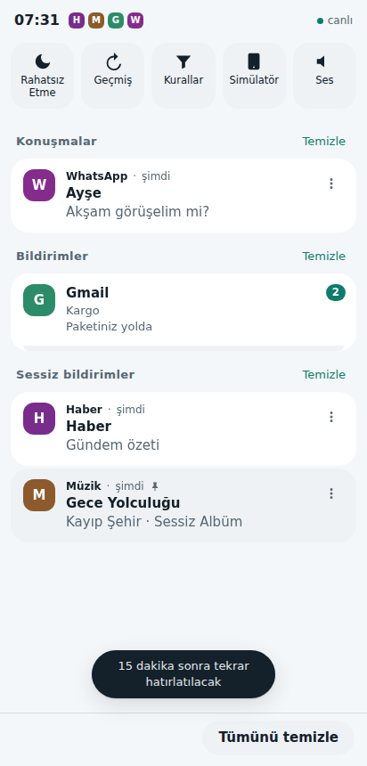
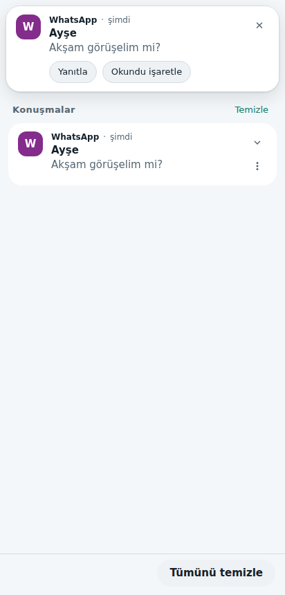

# Notivo Fullstack: Android bildirim çubuğunun backend + frontend uygulaması

Android'in bildirim çubuğunun nasıl çalıştığını (kanallar ve önem düzeyleri, yerinde güncelleme, bölümler, gruplama, süregelen bildirimler, kaydırarak kapatma,
heads-up, erteleme, zaman aşımı, Rahatsız Etme, geçmiş) bir web sunucusu ve tarayıcı arayüzü olarak yeniden kurar. Uygulamalar bildirimi HTTP API ile gönderir,
kullanıcı tarayıcıda gerçek zamanlı olarak görür ve Android'deki gibi yönetir. Mevcut Android uygulaması (`../notivo`) **olduğu gibi durur**; bu proje onun
kural, kopya engeli, silinen-mesaj tespiti ve Türkçe arama mantığını taşıyan ayrı bir kopyadır.

 

## Çalıştırma

```bash
cd notivo-fullstack
npm install        # yalnızca uçtan uca test için (playwright-core); sunucunun bağımlılığı yok
npm start          # http://localhost:8790
```

Gereksinim: Node.js ≥ 22.13 (yerleşik `node:sqlite` kullanılır). Arayüzde **Simülatör** düğmesi gerçek uygulamaların yaptığını taklit eder.
Veri `data/notivo.db` dosyasında (SQLite) kalır.

| Ortam değişkeni | Varsayılan | Anlamı |
|---|---|---|
| `PORT` | `8790` | Dinlenecek port |
| `HOST` | `127.0.0.1` | Yerel dışı bir adres için `NOTIVO_TOKEN` **zorunludur** (yoksa sunucu başlamaz) |
| `NOTIVO_TOKEN` | boş | Doluysa tüm `/api/*` için `Authorization: Bearer <token>` gerekir |
| `NOTIVO_DB` | `data/notivo.db` | Veritabanı dosyası |

## Kendi uygulamandan kullanma

```bash
# 1) kanal (bir kez). Önem: 0 NONE, 1 MIN, 2 LOW, 3 DEFAULT, 4 HIGH
curl -X POST localhost:8790/api/apps/com.ornek/channels -H 'content-type: application/json' \
  -d '{"id":"mesaj","name":"Mesajlar","importance":4,"appName":"Örnek"}'

# 2) bildirim (aynı id ile tekrar çağırırsan yerinde güncellenir)
curl -X POST localhost:8790/api/notify -H 'content-type: application/json' \
  -d '{"pkg":"com.ornek","channel":"mesaj","id":1,"title":"Merhaba","text":"İlk bildirim","conversation":true,
       "actions":[{"id":"reply","title":"Yanıtla","reply":true}]}'

# 3) uygulama tarafı geri çağrıları: dokunma, eylem/yanıt, kullanıcı kapatması (deleteIntent)
curl -N 'localhost:8790/api/events?pkg=com.ornek'
```

Başlıca uç noktalar: `POST /api/notify`, `/api/cancel`, `/api/cancel-all`, `/api/apps/:pkg/channels` (uygulama tarafı) ·
`GET /api/shade`, `POST /api/shade/{dismiss,dismiss-group,clear-all,click,action,snooze}` (kullanıcı tarafı) ·
`GET /api/history?q=&state=`, `GET/PUT /api/dnd`, `/api/rules`, `PATCH /api/apps/:pkg[/channels/:id]` · `GET /api/events` (SSE) ·
`GET /api/export.csv`, `/api/backup`, `POST /api/restore`. `notify` alanları: `pkg, channel, id, tag, title, text, bigText, subText, category,
group, groupSummary, ongoing, autoCancel, onlyAlertOnce, conversation, timeoutAfterMs, when, contentIntent, actions[≤3]`.

## Mimari

```
server/shade.js     çekirdek: Android davranışı (kanal, uyarı kararı, bölümler, gruplama, erteleme, geçmiş, kurallar)
server/textlogic.js Notivo Logic.kt portu (Türkçe normalizasyon, kural eşleme, silinen mesaj, CSV)
server/db.js        SQLite şeması
server/app.js       HTTP + SSE + statik dosya, güvenlik denetimleri
server/index.js     başlatıcı (ortam değişkenleri)
web/                build gerektirmeyen arayüz (index.html, style.css, app.js, sim.js)
test/               unit (Shade, metin mantığı), api (HTTP/güvenlik/SSE), e2e (gerçek Chromium)
docs/ANDROID_PARITY.md  hangi Android davranışı nerede, nasıl test edildi, bilgi kaynağı
```

## Güvenlik notları

- Değiştirici istekler `Content-Type: application/json` ister (form tabanlı çapraz-site POST reddedilir) ve yabancı `Origin` 403 alır.
- Token yokken yalnızca `localhost` Host başlığı kabul edilir (DNS rebinding savunması); yerel dışı kullanımda token zorunlu.
- Gövde ≤ 256 KB, alan uzunlukları sınırlı; arayüz bildirim içeriğini yalnızca `textContent` ile yazar; sıkı CSP (`default-src 'self'`).
- **TLS yoktur**: uzaktan kullanımda HTTPS'li bir ters vekilin (nginx, Caddy…) arkasına koyun. Veritabanı şifrelenmez.
- `?token=` yalnızca tarayıcının başlık ekleyemediği uçlarda (SSE, indirme) kabul edilir; token'lı adresleri paylaşmayın.

## Testler

```bash
npm test      # 51 test: Shade davranışları, Türkçe metin mantığı, HTTP, güvenlik, SSE, kalıcılık
npm run e2e   # gerçek Chromium: kaydırma, heads-up, gruplar, DND, geçmiş, kurallar, erteleme, XSS, konsol hatası
```

`docs/ANDROID_PARITY.md`: Android davranışlarının hangilerinin kaynakla doğrulandığını, hangilerinin genel bilgiye dayandığını ve hangilerinin yaklaşık olduğunu listeler.
